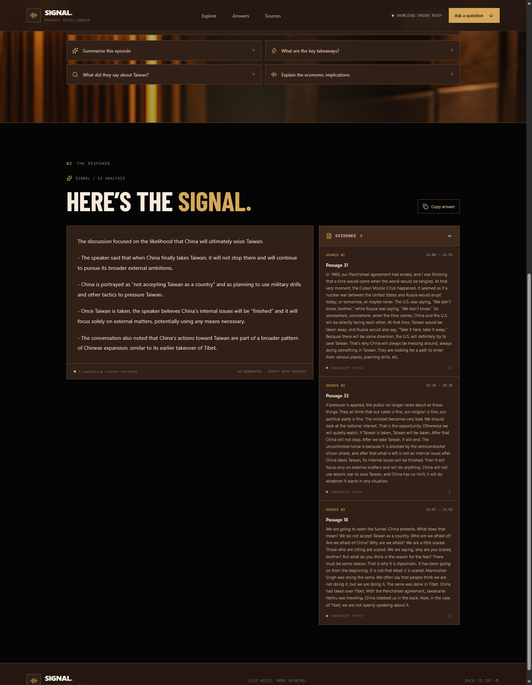
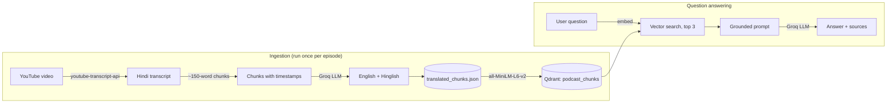

# SIGNAL: Podcast Knowledge AI

Ask questions about a podcast episode in plain English and get answers grounded in what was actually said, with timestamps pointing back to the exact moments in the conversation.

SIGNAL takes a Hindi YouTube podcast, translates the transcript into English and Hinglish, indexes it in a vector database, and answers questions using Retrieval-Augmented Generation (RAG). Every answer comes with the transcript passages it was based on, so you can verify it instead of trusting it blindly.



## Features

- **Grounded answers.** The model answers only from retrieved transcript passages and says so when the answer is not in the episode.
- **Source evidence.** Each answer shows the top matching passages with start and end timestamps.
- **Cross-language search.** The source audio is in Hindi; you ask in English and search runs over English translations.
- **English and Hinglish transcripts.** Every chunk is stored with its original Hindi text, an English translation, and a Hinglish transliteration.
- **Resumable translation.** The batch translator saves progress after every chunk, so it picks up where it stopped if interrupted.
- **Local or cloud vector storage.** Run Qdrant from a local folder with no account, or point it at Qdrant Cloud.

## How it works



1. **Transcript.** `TranscriptService` fetches the Hindi captions for a YouTube video.
2. **Chunking.** `ChunkingService` groups caption segments into chunks of about 150 words, keeping each chunk's start and end time.
3. **Translation.** `TranslationService` sends each chunk to Groq (`openai/gpt-oss-20b`) and gets back an English translation and a Hinglish transliteration. `BatchTranslationService` runs this over the whole episode and writes `translated_chunks.json`.
4. **Indexing.** `IngestionService` embeds each English chunk with the `all-MiniLM-L6-v2` sentence-transformer (384 dimensions) and stores it in the Qdrant collection `podcast_chunks`, with the original, English and Hinglish text plus timestamps as payload.
5. **Answering.** The `/ask` endpoint embeds the question, retrieves the 3 most similar chunks, and asks the LLM to answer using only that context. The response includes the answer and the source chunks.

## Tech stack

| Layer | Technology |
| --- | --- |
| Frontend | React 19, Vite, Framer Motion, Lucide icons |
| API | FastAPI, Uvicorn |
| LLM (translation and answers) | Groq API, `openai/gpt-oss-20b` |
| Embeddings | sentence-transformers, `all-MiniLM-L6-v2` |
| Vector database | Qdrant (local on-disk or Qdrant Cloud) |
| Transcript and metadata | youtube-transcript-api, yt-dlp |
| Relational schema (planned) | PostgreSQL, SQLAlchemy |

## Project structure

```
creator-knowledge-ai/
├── backend/
│   ├── main.py                        # FastAPI app: /, /health, /ask
│   ├── database/
│   │   └── qdrant_connection.py       # Shared Qdrant client (local or cloud)
│   └── services/
│       ├── transcript_service.py      # Fetch Hindi YouTube captions
│       ├── youtube_service.py         # Video metadata via yt-dlp
│       ├── chunking_service.py        # Split transcript into timed chunks
│       ├── translation_service.py     # Hindi -> English + Hinglish via Groq
│       ├── batch_translation_service.py  # Translate a full episode (resumable)
│       ├── embedding_service.py       # Sentence-transformer embeddings
│       ├── qdrant_service.py          # Create collection, store points
│       ├── ingestion_service.py       # Load translated_chunks.json into Qdrant
│       ├── search_service.py          # Semantic search over chunks
│       └── answer_service.py          # RAG prompt + answer generation
├── database/
│   └── schema.sql                     # PostgreSQL schema for creators, videos, transcripts
├── frontend/                          # React + Vite web app
├── translated_chunks.json             # Translated chunks for the indexed episode
├── requirements.txt
└── .env                               # Your API keys (not committed)
```

## Getting started

### Prerequisites

- Python 3.13 (tested)
- Node.js 20 or newer
- A free [Groq API key](https://console.groq.com/keys)

### 1. Clone and install the backend

```powershell
git clone https://github.com/adnan098raza/Creator-knowledge-ai..git
cd Creator-knowledge-ai.
python -m venv venv
.\venv\Scripts\Activate.ps1
python -m pip install -r requirements.txt
```

On macOS or Linux, activate with `source venv/bin/activate`.

### 2. Configure environment variables

Create a `.env` file in the project root:

```env
GROQ_API_KEY=your_groq_api_key

# Option A: local Qdrant stored in a folder (no account needed)
QDRANT_PATH=qdrant_data

# Option B: Qdrant Cloud (used only when QDRANT_PATH is not set)
# QDRANT_URL=https://your-cluster.cloud.qdrant.io
# QDRANT_API_KEY=your_qdrant_api_key
```

### 3. Load the podcast into Qdrant

The repository already includes `translated_chunks.json`, so you only need to index it:

```powershell
python -m backend.services.ingestion_service
```

The embedding model downloads automatically the first time (about 90 MB).

### 4. Start the API

```powershell
python -m uvicorn backend.main:app --reload --host 127.0.0.1 --port 8000
```

Check http://127.0.0.1:8000/health, or try the API at http://127.0.0.1:8000/docs.

### 5. Start the frontend

In a second terminal:

```powershell
cd frontend
npm install
npm run dev
```

Open http://localhost:5173 and ask a question.

## API

### `POST /ask`

Request:

```json
{ "question": "What was discussed about China and Taiwan?" }
```

Response:

```json
{
  "answer": "The discussion focused on ...",
  "sources": [
    {
      "chunk_index": 31,
      "start_time": 1446.0,
      "end_time": 1492.0,
      "text": "In 1960, our Panchsheel agreement had ended ..."
    }
  ]
}
```

Returns `503` if Qdrant is unreachable and `500` for other failures (details are logged in the API terminal).

### `GET /health`

Returns `{"status": "healthy"}` when the API is up.

## Adding a new episode

1. Set `VIDEO_ID` at the bottom of `backend/services/batch_translation_service.py` to the YouTube video ID (the part after `watch?v=`). The video needs Hindi captions.
2. Move or delete the existing `translated_chunks.json`, because the batch translator resumes from whatever is already in that file.
3. Translate the episode:
   ```powershell
   python -m backend.services.batch_translation_service
   ```
4. Index it:
   ```powershell
   python -m backend.services.ingestion_service
   ```

Chunk IDs come from `chunk_index`, so indexing a second episode overwrites the first. Supporting several episodes at once is on the roadmap.

## Troubleshooting

- **`/ask` returns 503 "Could not connect to Qdrant".** If you use Qdrant Cloud, check that the cluster is running in the Qdrant console (free clusters are suspended after inactivity). Otherwise switch to local storage with `QDRANT_PATH=qdrant_data` and run the ingestion step.
- **"Storage folder qdrant_data is already accessed by another instance".** Local Qdrant allows one process at a time. Stop the API before running ingestion.
- **Frontend shows "I couldn't reach the backend".** Make sure the API is running on port 8000.
- **The first question is slow.** The embedding model loads on the first request; later questions are faster.

## Roadmap

- Support multiple episodes and creators, with episode filtering in search
- Store creators, videos and transcripts in PostgreSQL using `database/schema.sql`
- Link each source timestamp to the matching moment in the YouTube video
- Show Hinglish and original Hindi text alongside English sources in the UI
- Deploy the API and frontend

## Author

Adnan Raza ([@adnan098raza](https://github.com/adnan098raza))
